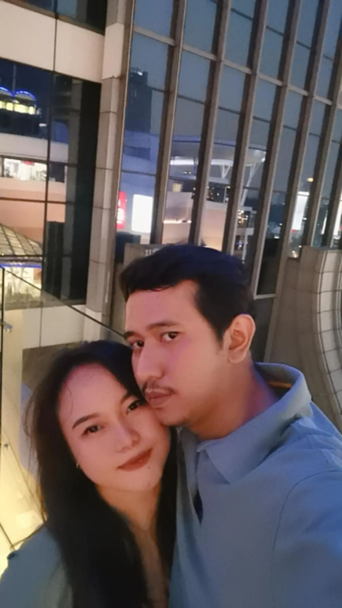

<html lang="id">
<head>
  <meta charset="UTF-8">
  <title>Undangan Pernikahan Jody & Laura</title>
  <link rel="stylesheet" href="style.css">
  
</head>
<body>
   <header>
  <h1 class="fade-in">💍 Undangan Pernikahan</h1>
  <h2 class="fade-in delay">Jody Alfian Rahmady & Laura Aprilia</h2>
</header>

  <section class="details">
    
Dengan penuh rasa syukur, kami mengundang Bapak/Ibu/Saudara/i untuk hadir dalam acara pernikahan kami.

    <h3>📅 Minggu, 25 Oktober 2026</h3>
    <h3>🕒 Pukul 10.00 WIB</h3>
    <h3>📍 Gedung Serbaguna Kebon Baru, Jakarta Selatan</h3>
    <a href="https://maps.google.com" target="_blank">Lihat Lokasi di Google Maps</a>
  </section>

  <section class="countdown">
    <h2>Hitung Mundur Menuju Hari H</h2>
    

  </section>

  <section class="rsvp">
    <h2>Konfirmasi Kehadiran</h2>
    <button onclick="konfirmasi()">Konfirmasi via WhatsApp</button>
  </section>

  <footer>
    
Terima kasih atas doa dan restunya 💕

	<section class="gallery">
  <h2>Galeri Prewedding</h2>
  

    
    
    
  

</section>
<section class="music">
  <h2>🎶 Musik Latar</h2>
  <audio id="bg-music" controls autoplay loop>
    <source src="images/music/Mariah Carey, Joe, 98 Degrees - Thank God I Found You (Official HD Video).mp3" type="audio/mpeg">
    Browser Anda tidak mendukung audio.
  </audio>
</section>
  </footer>
  <canvas id="flowerCanvas"></canvas>
</body>
</html>
